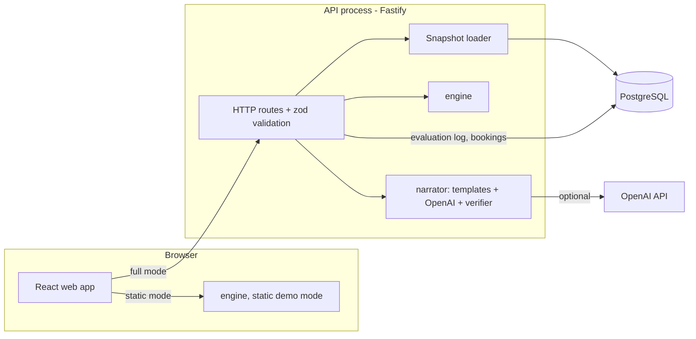

# 01 — Architecture

## Principles (non-negotiable)

1. **The engine decides; nothing else does.** Feasibility, reasons, alternatives and policy fixes come only from `@whynot/engine`. The API, UI and AI never compute or alter them.
2. **The engine is pure.** No I/O, no clock, no randomness, no environment access. Input → output. It runs unchanged in the browser and in Node.
3. **Deterministic.** Same snapshot + request + `now` + options ⇒ byte-identical result, regardless of input ordering.
4. **Every claim is traceable.** Every reason is a `Fact` with a stable ID, rule ID and rule version. Every sentence shown to a user cites facts.
5. **Privacy lives in data, not in UI.** Facts carry a `visibility`. Projection to the patient audience happens in one tested function before anything leaves the server or engine.
6. **Templates first, AI second.** Every output can be rendered without a model. The AI path is optional polish behind a verifier.
7. **Small and boring infrastructure.** One API process, one Postgres, one static web build. No queues, microservices, vector DBs or agent frameworks.

## System overview



### Request flow: "Why can't I book 14:30 with Dr. Rao?"

1. Web sends `POST /api/explain { patientId, serviceId, start, practitionerId? }`.
2. API validates with the shared zod schema, then loads a `ClinicSnapshot` covering the request day ± the alternatives search window.
3. API calls `engine.evaluate(snapshot, request, { now, audience: 'staff' })` → `Evaluation` (bookable assignment, or explanation + alternatives + admin fix).
4. API stores the full staff-level evaluation in `evaluations` (for insights), then projects it to the caller's audience (`patient` strips staff-only facts).
5. Web renders the template wording immediately. If AI wording is enabled, it calls `POST /api/narrate` which returns verified narration (or the template if verification fails).

## Runtime modes

| Mode | What runs | Use |
| --- | --- | --- |
| **Static demo** | Web + engine in browser, bundled fixture snapshot, pre-generated verified narrations | GitHub Pages; zero cost; reviewers |
| **Full local** | Docker Compose: Postgres + API + web; OpenAI optional | Development and complete demo |
| **Hosted full** (optional, Phase 7) | Same as full local on a cheap host | Only if wanted; decided in Phase 7 |

The static demo is possible *only because* the engine is pure. This is a key architectural payoff and must be protected (lint rule: engine may not import Node built-ins or I/O libraries).

## Repository layout (target)

```
whynot/
  package.json               # pnpm workspace root, scripts: check, test, bench, dev
  pnpm-workspace.yaml
  tsconfig.base.json
  AGENTS.md                # standing rules for coding agents (Codex)
  .agents/skills/          # project skills (session protocol, engine, api, ui, testing, narration, review)
  packages/
    contracts/               # zod schemas + TS types shared by everything
      src/snapshot.ts        # ClinicSnapshot, resources, policies
      src/request.ts         # BookingRequest
      src/evaluation.ts      # Evaluation, Fact, Alternative, AdminFix
      src/api.ts             # HTTP request/response schemas
    engine/                  # pure TS; depends only on contracts + luxon
      src/time.ts            # wall-clock <-> instant, intervals (only file using luxon)
      src/rules/             # one file per rule family; each exports check fns
      src/catalog.ts         # rule registry: id, version, kind, weight, visibility, relaxableBy
      src/candidates.ts      # candidate enumeration
      src/matrix.ts          # violation matrix (candidate -> violated fact IDs)
      src/explain.ts         # minimum-weight hitting set
      src/alternatives.ts    # counterfactual search + ranking + diversity
      src/adminFix.ts        # minimal correction set over admin-relaxable facts
      src/project.ts         # audience projection (patient/staff)
      src/evaluate.ts        # public entry point
      src/reference/         # naive reference implementation for differential tests
      test/ bench/
    narrator/                # templates, OpenAI client, verifier; no DB
      src/templates/         # per-rule templates, per audience
      src/openai.ts
      src/verify.ts
      src/narrate.ts
    fixtures/                # Riverside Family Clinic generator + hero scenarios
      src/clinic.ts          # deterministic seed data relative to a demo date
      scenarios/*.json       # golden scenarios with expected outcomes
      src/generate.ts        # random snapshot/request generator for property tests
  apps/
    api/                     # Fastify + Drizzle + Postgres
      src/db/schema.ts  src/db/migrations/
      src/snapshotLoader.ts
      src/routes/*.ts
    web/                     # React + Vite
      src/pages/Booking.tsx  src/pages/Insights.tsx  src/pages/Simulator.tsx  src/pages/Inspector.tsx
      src/components/WhyNotPanel.tsx ...
      src/static/            # static-mode adapter (engine in browser)
  tools/
    eval-narration/          # narration evaluation runner
  docs/
  docker-compose.yml
  .github/workflows/ci.yml
```

### Dependency rules

```
contracts  <-  engine  <-  narrator
    ^            ^            ^
    +------------+------------+---- fixtures (dev/test only)
                 |
            apps/api, apps/web
```

- `engine` imports only `contracts` and `luxon`.
- `narrator` imports `contracts` (and `engine` types only); never the DB.
- `apps/web` never imports `narrator`'s OpenAI client (no keys in the browser). It may import `narrator/templates` for template rendering.
- Enforced with ESLint `no-restricted-imports` per package.

## Tech stack

| Concern | Choice | Why |
| --- | --- | --- |
| Language | TypeScript (strict) | One language end to end; engine shared by browser and server |
| Package manager / monorepo | pnpm workspaces | Simple, fast, no extra build orchestrator needed at this size |
| Schemas | zod | Runtime validation + inferred types; single source of truth in `contracts` |
| Time | luxon (isolated in `engine/src/time.ts`) | Mature IANA timezone handling; swap later for Temporal if desired |
| API | Fastify | Fast, typed, schema-friendly, small |
| DB | PostgreSQL 16 + Drizzle ORM | Typed queries, SQL-first migrations |
| Web | React 18+ + Vite + TanStack Query + React Router | Standard, fast dev loop |
| Styling | Tailwind CSS | Speed; consistent design without a design-system project |
| Charts | Recharts | Enough for insights dashboard |
| AI | OpenAI API (Responses API with structured JSON output); model set by env `OPENAI_MODEL` | User's choice for cost; isolated behind `Narrator` interface so it can be swapped |
| Tests | Vitest, fast-check (property tests), Playwright (e2e), axe-core (a11y) | Proof-oriented testing |
| CI | GitHub Actions | lint, typecheck, unit/property tests, build; e2e on main |
| Local infra | Docker Compose (Postgres) | One command to run |

Exact library versions are pinned in Session 0.1 and recorded in the decision log.

## Cross-cutting concerns

- **Time:** all instants are integers of **epoch minutes (UTC)** inside the engine. Wall-clock rules (working hours, opening hours) are converted per date in the clinic's IANA timezone in `time.ts`. Tests cover a DST-observing zone (`Europe/London`) and a non-DST zone (`Asia/Kolkata`).
- **Clock:** `now` is always a parameter. The demo uses a frozen **demo clock** (see doc 05) so scenarios stay stable forever.
- **Versioning:** `ENGINE_VERSION` (semver, in engine), `ruleVersion` per rule, `policyVersionId` per snapshot, `PROMPT_VERSION` in narrator. All are stored with each evaluation/narration.
- **Errors:** engine never throws for business outcomes; invalid requests return `outcome: 'invalid_request'` with reasons. Exceptions mean bugs.
- **Observability:** API logs one structured line per request (route, duration, outcome, engine timing breakdown). No patient names in logs.
- **Security (demo-level, but done right):** no real auth (role switcher), input size limits, rate limiting on explain/narrate, OpenAI key only server-side, CORS restricted, no secrets in repo.
